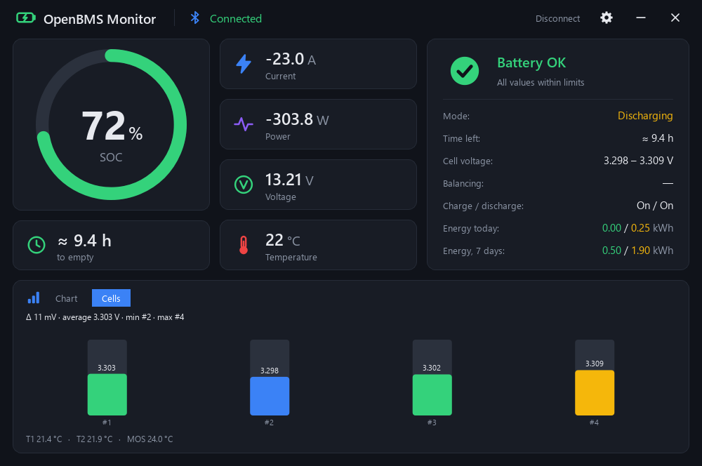
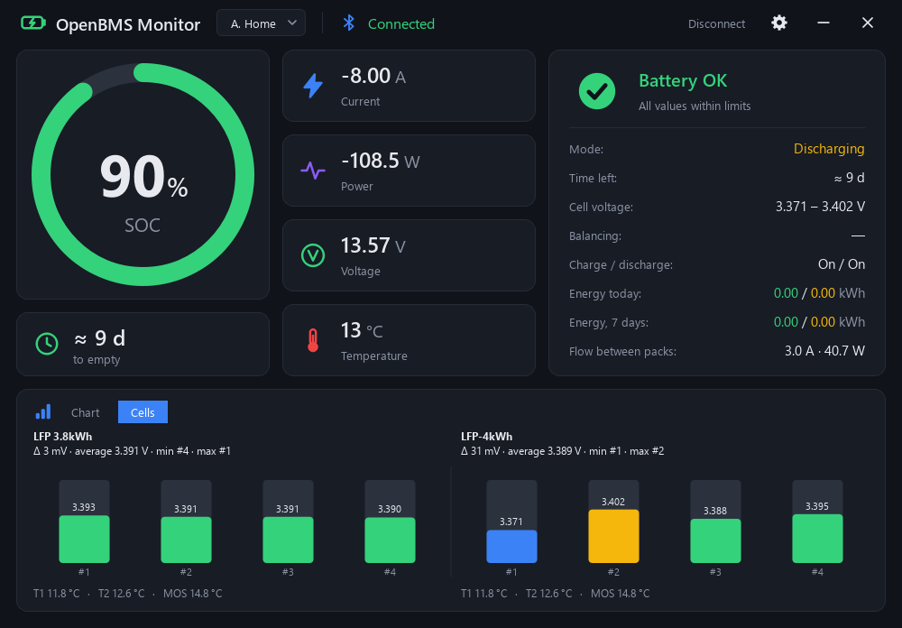

# OpenBMS Monitor

A small, **read-only**, open-source Windows desktop monitor for battery
**BMS** over Bluetooth Low Energy: **JK (Jikong)** today, JBD, Daly and ANT
in progress. It shows state of charge, current, power, pack voltage, time
to full/empty and active alarms right on the Windows taskbar, in a floating
widget, or in a full dashboard with a 7-day history chart. Several BMS can
be watched at once, and packs wired in parallel or in series can be shown as
one battery.

Built for a home backup battery (4S LiFePO4), where the PC itself runs from
the battery and you want to see what it is doing at a glance. Formerly
*JK BMS Monitor*.


| Taskbar strip | Floating widget |
|---|---|
|  |  |

<details><summary>Cells tab</summary>



</details>

<details><summary>A bank of two packs in parallel</summary>



</details>

*Screenshots use demo data. The interface is available in **English** and
**Ukrainian** (follows the Windows display language, can be changed in
settings).*

## Features

- **Taskbar strip** (default): battery icon (fill = SOC, lightning bolt while
  charging, red badge on faults), SOC, voltage, current, power and time to
  full/empty, placed next to the system tray. Drag it along the taskbar.
  During full-screen apps it hides or moves to the screen corner.
- **Floating widget**: small frameless window, drag anywhere. Always on top
  by default, or pinned to the desktop (under other windows, still visible
  after *Show desktop*).
- **Several BMS at once**: add more BMS in *Settings → BMS*; each gets its
  own numbered taskbar strip (side by side) or widget, the dashboard has a
  selector. The eye icon (settings, selector or right-click menu) hides a
  strip or widget; its data and history keep being recorded.
- **Banks**: group BMS in *Settings → Banks* and show them as one battery
  with its own strip, chart and energy counters. Each bank gets a letter
  you pick, like a drive letter.
  - *Parallel*: total current and power, capacity-weighted SOC, a "flow
    between packs" row when one pack charges another (it cancels in the
    total). A BMS without data is left out of the sums, with a warning.
  - *Series*: voltages add up, common current, SOC and time left follow the
    weakest pack. A BMS without data counts with its last voltage for a
    minute, then the bank reports "no data".
  - Cells tab: one group per pack with its own spread (parallel 1234 1234,
    series 1234 5678 plus the spread of all cells).
  - Low charge / full notifications come from the bank, alarms from each BMS.
- **Dashboard**: SOC ring, current, power, voltage, temperature, cell
  voltage range, balancing, MOSFET state, health summary.
- **History chart**: SOC and current for 1 h / 6 h / 24 h / 7 days, stored
  per BMS and per bank in SQLite, survives restarts. Hover to see time, SOC,
  current, voltage and power. Colours show charge (green), discharge (amber)
  and idle (grey, below the idle threshold from the settings).
- **Cells tab**: every cell voltage as a bar (lowest blue, highest amber),
  spread in mV, average, balancing, temperatures.
- **Energy counters**: kWh charged / discharged today and over 7 days.
- **Windows notifications**: low charge (threshold in settings; SOC also
  turns red on the strip, widget and tray icon), new BMS alarms, connection
  lost for a minute, fully charged. Each fires once.
- **Update check**: once a day the app asks GitHub for the latest release
  number and offers the download page. It never downloads or installs
  anything by itself; can be turned off in *Settings → System*.
- **CSV export** of the history (menu → *Export history (CSV)…*).
- **Alarms in plain language**: click the indicator for the list of active
  protections (e.g. cell undervoltage, charge overtemperature).
- **Charging / Discharging / Idle** with a configurable idle threshold, so an
  inverter's standby draw does not flicker the state.
- **Robust connection**: automatic reconnect, clear "disconnected" state,
  manual disconnect to free the BMS for the phone app.
- **Diagnostic capture** of any BMS (also unsupported brands) for adding
  new decoders, with private data removed.
- Remembers the selected BMS and window positions; tray icon; start with
  Windows; single instance; UI scaling; English / Ukrainian; widgets fade
  and become click-through while another window is maximized.

## Read-only by design

The app sends only fixed **read requests**. To a JK BMS it can send exactly
two frames: device info (`0x97`) and cell info (`0x96`)
([`drivers/jk/commands.py`](jkbms_widget/drivers/jk/commands.py)); every
other brand's driver lists its few read frames the same way
([`drivers/`](jkbms_widget/drivers)). Every outgoing write passes through one
function that checks the **whole frame** against that driver's allowlist;
anything else raises `ForbiddenCommandError` and is never sent. There is no
code that changes BMS settings, switches MOSFETs or sends passwords, and
there never will be: use the manufacturer's app for that.

The only internet access is the optional daily update check: it reads the
latest release number from the GitHub API and sends no personal data.

## Supported hardware

| BMS | Hardware / software | Status |
|---|---|---|
| JK_B1A8S20P | HW 11A, SW 11.53 | tested daily |
| JK-B2A8S20P | HW 19H, SW 19.34 | tested (decoding verified at idle) |
| Other JK-B "JK02_32S" models (HW ≥ 11) | — | expected to work, untested |
| Older JK-B (HW < 11, JK02_24S) | — | parser exists, untested |
| JBD / Xiaoxiang, Daly / 100Balance, ANT | — | **diagnostic recording only** — help wanted |
| JK04, JK-PB (inverter BMS), other brands | — | not supported yet |

### Help add your BMS

Own a JBD, Daly, 100Balance, ANT or a JK model not listed above? The app
can record a 60-second, read-only **diagnostic capture** (menu → *Record
diagnostics…*) with private data removed. Attach it to a
[“Add my BMS” issue](https://github.com/linux2020l/OpenBMS-Monitor/issues/new?template=bms-capture.yml);
that is all a new decoder needs. Step-by-step guide:
[docs/captures.md](docs/captures.md).

## Getting started

### Install

1. Download `OpenBmsMonitor-Setup-x.y.z.exe` from
   [Releases](https://github.com/linux2020l/OpenBMS-Monitor/releases) and run
   it. No administrator rights are needed; the app is installed for the
   current user (`%LOCALAPPDATA%\Programs\OpenBmsMonitor`) and can be removed in
   *Settings → Apps*. Your settings and history are kept on uninstall.
   Updating from *JK BMS Monitor* (before v0.8.0) replaces the old app and
   keeps settings, history and "start with Windows".
2. The installer is not code-signed, so Windows SmartScreen may show
   "Windows protected your PC": click *More info → Run anyway*.
3. Close the BMS phone app (or disconnect it). A BMS accepts only one
   Bluetooth connection at a time.
4. On the first start a dialog lists the BMS nearby (supported ones first):
   pick yours. The app connects to it from now on. More BMS can be added
   later in *Settings → BMS*.

Requires Windows 10 (1709 or newer) or Windows 11, 64-bit, with Bluetooth LE
(built-in or a USB dongle).
From source: `pythonw -m jkbms_widget` (see [Development](#development)).

Do **not** pair the BMS in Windows Bluetooth settings; the app connects
without pairing.

### Everyday use

- Left click on a strip/widget opens the dashboard for that BMS or bank;
  the ⚙ button opens settings; right click (or the tray icon) opens the
  menu: hide / remove this BMS or bank, connect / disconnect, add BMS,
  display mode, export CSV, record diagnostics, settings, exit. When a
  newer version exists, the menu starts with *Download version x.y.z…*.
- Settings (tabs): **BMS** (list, add, change, remove, show/hide),
  **Banks** (letter, name, parallel / series, member BMS), **Display**
  (taskbar / floating widget, widgets on the desktop, full-screen apps,
  scale, language, fading), **State and alerts** (idle threshold,
  notifications, low-charge threshold), **System** (start with Windows,
  data folder, CSV export, diagnostics, update check).
- Settings, chart history and a log are stored in `%APPDATA%\OpenBmsMonitor\`
  (`settings.json`, `history.sqlite`, `widget.log`). Delete the folder to
  reset everything.

## Development

Python 3.12, [bleak](https://github.com/hbldh/bleak) (BLE),
[PySide6](https://doc.qt.io/qtforpython-6/) (UI), pytest.

```powershell
py -3.12 -m venv .venv
.\.venv\Scripts\Activate.ps1
python -m pip install -r requirements-dev.txt
python -m pytest
```

If `Activate.ps1` is blocked, run `Set-ExecutionPolicy -Scope CurrentUser
RemoteSigned` once, or call `.\.venv\Scripts\python.exe` directly.

Useful commands:

```powershell
python -m jkbms_widget                     # the app (same as "widget")
python -m jkbms_widget widget --replay tests\fixtures\jk02_32s_b1a8s20p_windows.txt  # demo data, no BMS
python -m jkbms_widget commands            # print the only frames the app may send
python -m jkbms_widget scan                # list nearby BLE devices, supported BMS first
python -m jkbms_widget dump --address AA:BB:CC:DD:EE:FF --seconds 60
python -m jkbms_widget replay logs\dump-XXXX.txt --speed 0
```

`dump` prints the GATT table and decoded values and writes every raw
notification with a timestamp to `logs\dump-*.txt`. **Raw dumps contain the
BMS serial number and Bluetooth passcodes** (`logs/` is git-ignored). To
share a capture or add it as a test fixture, sanitize it first:

```powershell
python tools\make_fixture.py logs\dump-XXXX.txt tests\fixtures\NAME.txt --note "MODEL HW x SW y"
```

A test checks that every fixture has these fields blanked.

### Build the app and the installer

```powershell
winget install JRSoftware.InnoSetup   # once, for the installer
powershell -ExecutionPolicy Bypass -File build.ps1
```

Runs the tests, builds `dist\OpenBmsMonitor\OpenBmsMonitor.exe` with PyInstaller
(one folder, no console) and packs it into
`dist\OpenBmsMonitor-Setup-<version>.exe` with
[Inno Setup](https://jrsoftware.org/isinfo.php)
([installer/OpenBmsMonitor.iss](installer/OpenBmsMonitor.iss)). The version comes
from `jkbms_widget/__init__.py`.

### Releases (GitHub Actions)

Every push to `main` runs the tests on GitHub
([.github/workflows/tests.yml](.github/workflows/tests.yml)). To publish a
release, set the new version in `jkbms_widget/__init__.py`, commit, then
push a matching tag:

```powershell
git tag v0.8.0
git push origin v0.8.0
```

[.github/workflows/release.yml](.github/workflows/release.yml) then runs
`build.ps1` on a Windows runner and creates the GitHub release with the
installer attached. A tag that does not match the version fails the build.

### Translations

All visible text is in [`jkbms_widget/strings.py`](jkbms_widget/strings.py)
(Ukrainian, the original) and
[`jkbms_widget/strings_en.py`](jkbms_widget/strings_en.py) (English).
`tests/test_strings.py` checks that both define the same texts with the same
placeholders. Adding a language: copy `strings_en.py`, translate it, and
register it in `strings.LANGUAGES` and `LANGUAGE_OPTIONS`.

### Project layout

```
jkbms_widget/
  model.py           brand-independent battery data + alarm codes
  drivers/           one package per BMS family (base.py = what a driver provides)
    jk/              JK: commands.py (read-only allowlist), frames.py, parser.py
  capture.py         raw capture log format;  replay.py: play a capture back
  ble.py             bleak: scan, characteristic selection, the only write path
  dump.py            live logger with decoded console output
  state.py           state with hysteresis, time left, history buffer, kWh, CSV
  bank.py            banks: combined reading of packs in parallel or in series
  notifications.py   when to show low charge / alarm / lost / full
  diagnostics.py     shareable, sanitized capture of any BMS
  updates.py         daily check of the latest GitHub release (read-only)
  history_store.py   7-day per-BMS / per-bank history (SQLite)
  settings.py        settings.json (+ move of the pre-rename data folder)
  strings.py         all user-visible text (Ukrainian) + language switching
  strings_en.py      English texts
  sources.py         BLE / replay data sources (background thread -> Qt signals)
  win_taskbar.py     taskbar geometry, full-screen detection (Win32 via ctypes)
  autostart.py       start with Windows (HKCU Run key, exe only)
  app.py             controller: sources, views, tray, menu, persistence
  ui/                PySide6 views: taskbar strip, widget, dashboard, chart,
                     cells, settings, bank editor, alarm list, BMS picker,
                     diagnostics, theme, icons
tests/               pytest; fixtures/ holds sanitized real captures
tools/               make_fixture.py (sanitize dumps), make_icon.py
installer/           Inno Setup script for the Windows installer
build.ps1            test + build the app + build the installer
.github/workflows/   tests on every push, release on a version tag
CLAUDE.md            design notes, protocol notes and conventions
```

The protocol logic (`commands`, `frames`, `parser`, `state`) is pure Python
without BLE or UI imports, so it can be ported (e.g. to Android) together
with its test vectors. Protocol details, verified offsets and quirks (such
as the length-prefix byte on Windows notifications) are documented in
[CLAUDE.md](CLAUDE.md#jk-ble-protocol-notes).

## Limitations

- Windows only; Bluetooth LE only (no RS485/CAN).
- Only JK BMS is decoded so far; other brands can only record diagnostics.
- The taskbar strip is a topmost window placed over the taskbar (Windows 11
  has no API for taskbar widgets); vertical or auto-hiding taskbars are not
  supported.
- A bank trusts the connection type you choose (parallel / series); the app
  cannot see the wiring.

## Credits

Protocol details cross-checked against
[syssi/esphome-jk-bms](https://github.com/syssi/esphome-jk-bms)
(`jk_bms_ble` component). Read requests and Bluetooth details for JBD, Daly
and ANT come from
[syssi/esphome-jbd-bms](https://github.com/syssi/esphome-jbd-bms),
[syssi/esphome-ant-bms](https://github.com/syssi/esphome-ant-bms) and
[patman15/aiobmsble](https://github.com/patman15/aiobmsble) (facts only,
no code copied).

## License

[MIT](LICENSE)

## Disclaimer

Not affiliated with or endorsed by Jikong / JK BMS. "JK" and "Jikong" are
used only to name compatible hardware. Use at your own risk; the displayed
values come from the BMS and are for information only.
