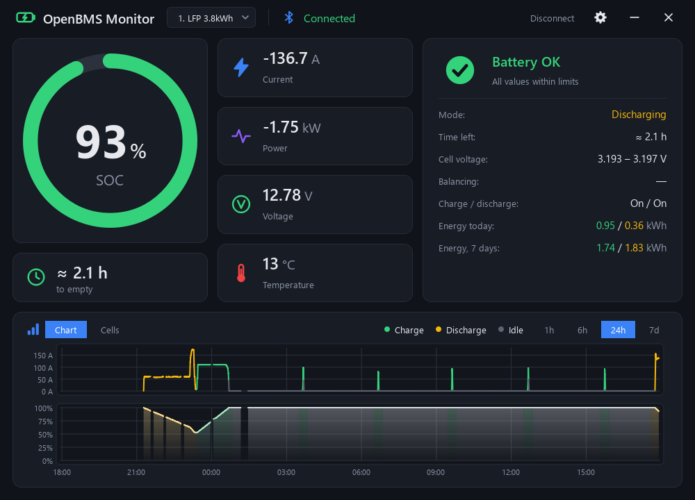

# JK BMS Monitor for Windows

A small, **read-only** Windows desktop monitor for **JK (Jikong) BMS** over
Bluetooth Low Energy. It shows state of charge, current, power, pack voltage,
time to full/empty and active alarms right on the Windows taskbar, in a
floating widget, or in a full dashboard with a 7-day history chart.

Built for a home backup battery (4S LiFePO4), where the PC itself runs from
the battery and you want to see what it is doing at a glance.



| Taskbar strip | Floating widget |
|---|---|
|  |  |

*Screenshots use demo data. The interface is available in **English** and
**Ukrainian** (follows the Windows display language, can be changed in
settings).*

## Features

- **Taskbar strip** (default): battery icon (fill = SOC, lightning bolt while
  charging, red badge on faults), SOC, voltage, current, power and time to
  full/empty, placed next to the system tray. Drag it along the taskbar.
  During full-screen apps it hides or moves to the screen corner.
- **Floating widget**: small always-on-top frameless window, drag anywhere.
- **Dashboard**: SOC ring, current, power, voltage, temperature, cell
  voltage range, balancing, MOSFET state, health summary.
- **History chart**: SOC and current for 1 h / 6 h / 24 h / 7 days, stored
  per BMS in SQLite, survives restarts. Hover to see time, SOC, current,
  voltage and power. Colours show charge (green) / discharge (amber).
- **Alarms in plain language**: click the indicator for the list of active
  protections (e.g. cell undervoltage, charge overtemperature).
- **Charging / Discharging / Idle** with a configurable idle threshold, so an
  inverter's standby draw does not flicker the state.
- **Robust connection**: automatic reconnect, clear "disconnected" state,
  manual disconnect to free the BMS for the phone app.
- Remembers the selected BMS and window positions; tray icon; start with
  Windows; single instance; UI scaling; widgets fade and become
  click-through while another window is maximized.

## Read-only by design

The app sends only fixed **read requests**. To a JK BMS it can send exactly
two frames: device info (`0x97`) and cell info (`0x96`)
([`drivers/jk/commands.py`](jkbms_widget/drivers/jk/commands.py)); every
other brand's driver lists its few read frames the same way
([`drivers/`](jkbms_widget/drivers)). Every outgoing write passes through one
function that checks the **whole frame** against that driver's allowlist;
anything else raises `ForbiddenCommandError` and is never sent. There is no
code that changes BMS settings, switches MOSFETs or sends passwords, and
there never will be: use the manufacturer's app for that.

## Supported hardware

| BMS | Hardware / software | Status |
|---|---|---|
| JK_B1A8S20P | HW 11A, SW 11.53 | tested daily |
| JK-B2A8S20P | HW 19H, SW 19.34 | tested (decoding verified at idle) |
| Other JK-B "JK02_32S" models (HW ≥ 11) | — | expected to work, untested |
| Older JK-B (HW < 11, JK02_24S) | — | parser exists, untested |
| JBD / Xiaoxiang, Daly / 100Balance, ANT | — | **diagnostic recording only** — help wanted |
| JK04, JK-PB (inverter BMS), other brands | — | not supported yet |

### Help add your BMS

Own a JBD, Daly, 100Balance, ANT or a JK model not listed above? The app
can record a 60-second, read-only **diagnostic capture** (menu → *Record
diagnostics…*) with private data removed. Attach it to a
[“Add my BMS” issue](https://github.com/linux2020l/JkBMS-PC-Monitor/issues/new?template=bms-capture.yml);
that is all a new decoder needs. Step-by-step guide:
[docs/captures.md](docs/captures.md).

Requirements: Windows 10/11 with Bluetooth LE (built-in or USB dongle).

## Getting started

### Install

1. Download `JkBmsWidget-Setup-x.y.z.exe` from
   [Releases](https://github.com/linux2020l/JkBMS-PC-Monitor/releases) and run
   it. No administrator rights are needed; the app is installed for the
   current user (`%LOCALAPPDATA%\Programs\JkBmsWidget`) and can be removed in
   *Settings → Apps*. Your settings and history are kept on uninstall.
2. The installer is not code-signed, so Windows SmartScreen may show
   "Windows protected your PC": click *More info → Run anyway*.
3. Close the JK phone app (or disconnect it). The BMS accepts only one
   Bluetooth connection at a time.
4. On the first start a dialog lists JK devices nearby: pick yours. The app
   connects to it from now on.

Requires Windows 10 (1709 or newer) or Windows 11, 64-bit, with Bluetooth LE.
From source: `pythonw -m jkbms_widget` (see [Development](#development)).

Do **not** pair the BMS in Windows Bluetooth settings; the app connects
without pairing.

### Everyday use

- Left click on the strip/widget opens the dashboard; the ⚙ button opens
  settings; right click (or the tray icon) opens the menu: connect /
  disconnect, choose BMS, display mode, settings, exit.
- Settings: BMS, display mode (taskbar / floating widget), behaviour during
  full-screen apps, scale, language, fading over maximized windows, idle
  threshold, start with Windows (installed app only).
- Settings, chart history and a log are stored in `%APPDATA%\JkBmsWidget\`
  (`settings.json`, `history.sqlite`, `widget.log`). Delete the folder to
  reset everything.

## Development

Python 3.12, [bleak](https://github.com/hbldh/bleak) (BLE),
[PySide6](https://doc.qt.io/qtforpython-6/) (UI), pytest.

```powershell
py -3.12 -m venv .venv
.\.venv\Scripts\Activate.ps1
python -m pip install -r requirements-dev.txt
python -m pytest
```

If `Activate.ps1` is blocked, run `Set-ExecutionPolicy -Scope CurrentUser
RemoteSigned` once, or call `.\.venv\Scripts\python.exe` directly.

Useful commands:

```powershell
python -m jkbms_widget                     # the app (same as "widget")
python -m jkbms_widget widget --replay tests\fixtures\jk02_32s_b1a8s20p_windows.txt  # demo data, no BMS
python -m jkbms_widget commands            # print the only frames the app may send
python -m jkbms_widget scan                # list nearby BLE devices, JK first
python -m jkbms_widget dump --address AA:BB:CC:DD:EE:FF --seconds 60
python -m jkbms_widget replay logs\dump-XXXX.txt --speed 0
```

`dump` prints the GATT table and decoded values and writes every raw
notification with a timestamp to `logs\dump-*.txt`. **Raw dumps contain the
BMS serial number and Bluetooth passcodes** (`logs/` is git-ignored). To
share a capture or add it as a test fixture, sanitize it first:

```powershell
python tools\make_fixture.py logs\dump-XXXX.txt tests\fixtures\NAME.txt --note "MODEL HW x SW y"
```

A test checks that every fixture has these fields blanked.

### Build the app and the installer

```powershell
winget install JRSoftware.InnoSetup   # once, for the installer
powershell -ExecutionPolicy Bypass -File build.ps1
```

Runs the tests, builds `dist\JkBmsWidget\JkBmsWidget.exe` with PyInstaller
(one folder, no console) and packs it into
`dist\JkBmsWidget-Setup-<version>.exe` with
[Inno Setup](https://jrsoftware.org/isinfo.php)
([installer/JkBmsWidget.iss](installer/JkBmsWidget.iss)). The version comes
from `jkbms_widget/__init__.py`.

### Translations

All visible text is in [`jkbms_widget/strings.py`](jkbms_widget/strings.py)
(Ukrainian, the original) and
[`jkbms_widget/strings_en.py`](jkbms_widget/strings_en.py) (English).
`tests/test_strings.py` checks that both define the same texts with the same
placeholders. Adding a language: copy `strings_en.py`, translate it, and
register it in `strings.LANGUAGES` and `LANGUAGE_OPTIONS`.

### Project layout

```
jkbms_widget/
  model.py           brand-independent battery data + alarm codes
  drivers/           one package per BMS family (base.py = what a driver provides)
    jk/              JK: commands.py (read-only allowlist), frames.py, parser.py
  capture.py         raw capture log format;  replay.py: play a capture back
  ble.py             bleak: scan, characteristic selection, the only write path
  dump.py            live logger with decoded console output
  state.py           state with hysteresis, time left, history buffer
  history_store.py   7-day per-BMS history (SQLite)
  settings.py        settings.json
  strings.py         all user-visible text (Ukrainian) + language switching
  strings_en.py      English texts
  sources.py         BLE / replay data sources (background thread -> Qt signals)
  win_taskbar.py     taskbar geometry, full-screen detection (Win32 via ctypes)
  autostart.py       start with Windows (HKCU Run key, exe only)
  app.py             controller: sources, views, tray, menu, persistence
  ui/                PySide6 views: taskbar strip, widget, dashboard, chart,
                     settings, alarm list, BMS picker, theme, icons
tests/               pytest; fixtures/ holds sanitized real captures
tools/               make_fixture.py (sanitize dumps), make_icon.py
installer/           Inno Setup script for the Windows installer
build.ps1            test + build the app + build the installer
CLAUDE.md            design notes, protocol notes and conventions
```

The protocol logic (`commands`, `frames`, `parser`, `state`) is pure Python
without BLE or UI imports, so it can be ported (e.g. to Android) together
with its test vectors. Protocol details, verified offsets and quirks (such
as the length-prefix byte on Windows notifications) are documented in
[CLAUDE.md](CLAUDE.md#jk-ble-protocol-notes).

## Limitations

- Windows only; Bluetooth LE only (no RS485/CAN).
- The taskbar strip is a topmost window placed over the taskbar (Windows 11
  has no API for taskbar widgets); vertical or auto-hiding taskbars are not
  supported.
- One BMS at a time.

## Credits

Protocol details cross-checked against
[syssi/esphome-jk-bms](https://github.com/syssi/esphome-jk-bms)
(`jk_bms_ble` component).

## License

[MIT](LICENSE)

## Disclaimer

Not affiliated with or endorsed by Jikong / JK BMS. "JK" and "Jikong" are
used only to name compatible hardware. Use at your own risk; the displayed
values come from the BMS and are for information only.
