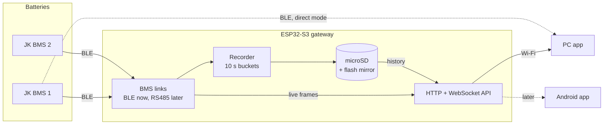
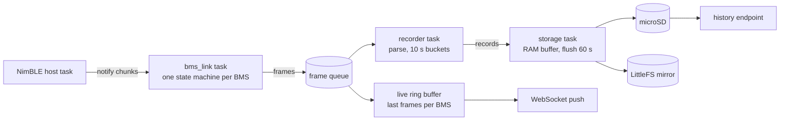
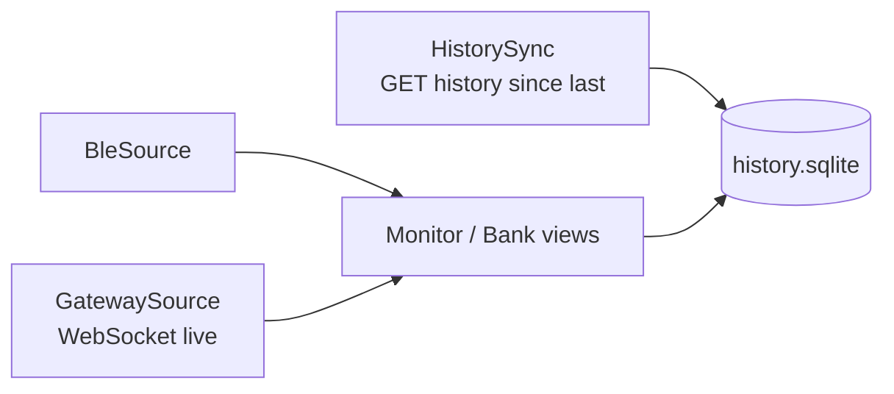

# OpenBMS Gateway (ESP32) — architecture

Status: **design draft**, nothing implemented yet. Owner's decisions so far are
in [Decisions](#decisions); open questions are at the end.

## Why

The PC app only records history while the PC is on and in BLE range. The
gateway is a small, optional, always-on module next to the batteries:

- it reads the BMS (read-only, same rules as the PC app),
- it stores the history on a microSD card,
- the PC app (and later the Android app) fetches the history over the local
  network when it starts, and shows live data through the gateway.

Without a gateway the PC app keeps working exactly as today (direct BLE).



## Decisions

| # | Decision | Date |
|---|---|---|
| D1 | Firmware in **ESP-IDF (C)**, FreeRTOS, NimBLE | 2026-11-15 |
| D2 | Network: **Wi-Fi only**. Ethernet is not planned for now (owner: too early, extra work); the `net` component keeps one interface so it could be added later | 2026-11-15 |
| D3 | Firmware lives in **this repository**, folder `firmware/` | 2026-11-15 |
| D4 | BMS link: **BLE first**, RS485 later as a second transport | 2026-11-15 |
| D5 | Power: **either a separate 5 V supply** (USB adapter, power bank, small UPS; simplest, the gateway draws little) **or B+** (before the BMS, keeps recording when the BMS cuts the load; low-voltage shutdown in software with a hardware backstop). A gateway setting says which; see [Power](#power-and-low-voltage-shutdown) | 2026-11-15 |
| D6 | Prototype hardware: **ESP32-S3 DevKitC + separate modules** (microSD, DS3231, buck converter) on a breadboard / carrier board | 2026-11-15 |
| D7 | Gateway history kept **until the card is 90 % full**, then the oldest days are deleted; a 4 GB card is enough | 2026-11-15 |
| D8 | Releasing BLE for the phone app: **from the PC app menu** only (no automatic window, no button) | 2026-11-15 |
| D9 | v1 API: **plain HTTP + token, local network only**, used by our app; access from outside the home is planned later and needs its own design | 2026-11-15 |
| D10 | Home Assistant / MQTT: **later**, as an optional extra publisher | 2026-11-15 |

## Hard rules (same as the PC app)

1. **Read-only.** The gateway only ever sends the documented read requests
   of each driver (JK: `0x97` device info, `0x96` cell info). Exactly one
   function writes to a BMS (`bms_link_send_request`), and it checks the
   whole frame against the driver's allowlist first. No API endpoint
   forwards bytes to a BMS. No settings / register-write commands, not even
   behind a flag.
2. **Shared protocol knowledge.** Request frames, parser offsets and alarm
   bits come from the same documentation as the PC app (`CLAUDE.md`, JK
   protocol notes), and the C code is tested against the same real captures
   (`tests/fixtures/`), see [Testing](#testing).
3. **Privacy.** The gateway blanks the BLE passcodes and the serial number in
   device-info frames before it stores or serves them (same fields as
   `drivers/jk/privacy.py`). Logs never contain them.
4. **Optional module.** Every PC app feature keeps working without a
   gateway.

## Hardware

| Part | Choice | Notes |
|---|---|---|
| MCU | **ESP32-S3-N16R8** (16 MB flash, 8 MB PSRAM) | e.g. ESP32-S3-DevKitC-1; BLE 5 + Wi-Fi, native USB |
| Storage | microSD, **SDMMC 1-bit** (SPI as fallback) | any 4–32 GB card, FAT32 |
| Clock | **DS3231** RTC (I²C) with a coin cell | keeps time through blackouts without internet |
| Network | Wi-Fi (built in) | Ethernet not planned for now (D2) |
| Power | separate 5 V USB supply, **or** fuse at B+ + wide-input **low-Iq buck with an EN pin** (hardware UVLO) + B+ voltage divider to an ADC pin | see [Power](#power-and-low-voltage-shutdown) |
| UI | 1 status LED, 1 button | button: Wi-Fi setup on long press (BLE release is a PC menu item, D8) |
| Later | isolated RS485 transceiver (ADM2587E or module) | phase 2 (D4) |

### Shopping list (D6)

**Which ESP32.** Any board below works; the firmware targets the S3 first.

| Board | Verdict | Why |
|---|---|---|
| ESP32-S3-DevKitC-1 **N16R8** (original or a clone, e.g. "YD-ESP32-S3") | **recommended** | 16 MB flash (two 3 MB OTA slots + a big flash mirror), 8 MB PSRAM for buffers and the web page, BLE 5, native USB, SDMMC |
| ESP32-S3 **N8R8** board | fine | 8 MB flash: OTA still fits, the flash mirror is smaller |
| ESP32-S3 board **with a built-in microSD slot** (several "S3 CAM" boards) | fine, less wiring | check that it has PSRAM and which GPIOs the slot uses |
| ESP32-S3 SuperMini / Zero (N4 / no PSRAM) | not for this | too little flash and RAM for OTA + mirror + buffers |
| ESP32-C6 / C3 | possible, later | single core, no PSRAM, SD over SPI only; would need a smaller build |
| classic ESP32-WROOM-32 | not recommended | BLE 4.2, 4 MB flash, no native USB |

Avoid boards labelled only "ESP32-S3" without the N/R code: N = flash MB,
R = PSRAM MB. Buy two boards if they are cheap: one stays on the desk for
development while the other runs next to the batteries.

**Stage 1 (G1–G2): board only**

| Part | Qty | Notes |
|---|---|---|
| ESP32-S3-DevKitC-1 N16R8 | 1–2 | see above |
| USB-C cable **with data lines** | 1 | many cheap cables are charge-only |
| 5 V USB adapter | 1 | any phone charger (≥ 1 A) |

**Stage 2 (G3): storage and clock**

| Part | Qty | Notes |
|---|---|---|
| microSD card | 1–2 | **high-endurance** type (made for dash cams / CCTV); 4–32 GB, FAT32. Even the smallest endurance cards (32 GB) are fine |
| microSD breakout, **3.3 V** | 1 | without a 5 V regulator / level shifter (not needed on a board with a slot) |
| DS3231 RTC module | 1 | e.g. ZS-042 or a "mini" DS3231; with a CR2032 (not rechargeable) remove the ZS-042's charging resistor / diode |
| CR2032 coin cell | 1 | for the RTC |
| Breadboard + Dupont jumper wires (M-M, M-F) | 1 set | |
| LED + 330 Ω, tactile button | 1 each | status / Wi-Fi setup |

**Power, option A: separate supply (simplest)**

Nothing else to buy: the gateway runs from any 5 V USB source. Note: an
adapter plugged into the inverter output goes dark together with the load
when the BMS trips; a power bank with pass-through charging or a small 5 V
UPS keeps recording through that. The firmware then skips the low-voltage
shutdown (setting `power_source = usb`).

**Power, option B: from B+ (later, with the power manager in G3)**

| Part | Qty | Notes |
|---|---|---|
| Inline fuse holder + 1 A fuses | 1 + spares | at the B+ terminal; this wire is not protected by the BMS |
| Buck converter module | 1 | input above the full pack voltage (4S LiFePO4: 14.6 V; 8S / 16S need more), 5 V or 3.3 V out, **EN pin**, low idle current (≤ 25 µA, e.g. a module on TPS62175 or a similar low-Iq chip; check the datasheet). Avoid LM2596 / XL4015 modules: several mA idle |
| 1 % resistors (100 k, 1 M assortment) + 100 nF capacitors | 1 set | B+ → ADC divider and EN-pin divider (values in the hardware notes) |
| Wire + ring terminal for B+ / B− | | |

**Later (G6): RS485.** An isolated RS485 transceiver module (ADM2587E or
similar) and the JK RS485 / UART connector cable for the BMS; not needed
before the wired port has been captured.

G1–G2 need only the board on USB; the SD card and RTC come in G3, and so
does the power manager for option B.

Power budget: ESP32-S3 with Wi-Fi in modem-sleep ≈ 0.5–1 W, i.e. 12–24 Wh a
day (≈ 0.3–0.6 % of a 4 kWh pack). For the PC to reach the gateway during a
blackout, the router must be on backup power too.

## Firmware

### Components (`firmware/components/`)

| Component | Pure C, host-tested | Job |
|---|---|---|
| `jk_proto` | yes | request allowlist, frame assembler (chunks → CRC-valid 300-byte frames, BCD prefix quirk, acks), cell-info / device-info parser, alarm bits, privacy scrub |
| `record` | yes | 32-byte history record: encode, decode, CRC; 10 s bucket aggregator |
| `history_fs` | yes (on a fake FS) | daily files, append, recovery of a torn tail, range queries |
| `bms_link` | no | per-BMS state machine over a transport; the single write function |
| `ble_central` | no | NimBLE central: scan, connect, GATT discovery by properties, notify, several connections |
| `rs485` | no | phase 2 |
| `clock` | partly | DS3231 + SNTP + time set by the PC; "time valid" flag |
| `power` | yes (state machine) | low-voltage shutdown: own B+ measurement + BMS data, deep sleep, wake-up checks |
| `net` | no | Wi-Fi STA, Wi-Fi setup access point, mDNS |
| `api` | partly (JSON builders) | `esp_http_server` REST + WebSocket |
| `config` | no | NVS: Wi-Fi, BMS list, API token, options |

`jk_proto`, `record` and `history_fs` have **no ESP-IDF includes**, so the
same files build on the PC for unit tests and can later be reused by an
Android NDK port if wanted.

### Tasks and data flow



- **bms_link state machine** (per BMS): `idle → connecting → subscribing →
  requesting (0x97, then 0x96 every 5 s until data) → streaming → (no data
  10 s) → reconnect after 5 s`. Same timings as `sources.BleSource`. Extra
  state **`released`**: disconnected on purpose until a deadline so the JK
  phone app can connect (PC app menu → `POST /release`, D8).
- **recorder**: one aggregator per BMS, the same rule as `state.History`:
  bucket start = `t − t mod 10`, SOC = last reading, current and voltage =
  mean, plus min cell, max cell, max temperatures, OR of alarm bits,
  MOSFET / balancing flags at the end of the bucket.
- **storage**: records are kept in RAM and flushed every 60 s (or after 16
  records = one SD sector) with `fsync`. A sudden power cut loses at most a
  minute. The last 7 days are also written to the internal flash
  (LittleFS, ring) so the gateway still has recent history if the card fails
  or is removed.

### Flash layout (16 MB)

| Partition | Size |
|---|---|
| nvs | 24 KB |
| otadata | 8 KB |
| ota_0 / ota_1 | 3 MB each |
| coredump | 64 KB |
| littlefs (history mirror) | rest, ≈ 9.8 MB |

### Power and low-voltage shutdown

Two ways to power the gateway (D5), chosen by the setting
`power_source`:

- **`usb`: a separate 5 V supply** (USB adapter, power bank, small UPS).
  Simplest; the gateway draws ≈ 0.5–1 W. No low-voltage shutdown is needed
  because the gateway does not drain the pack. Everything below is skipped.
- **`b_plus`: from B+, before the BMS.** It keeps recording while the BMS
  has switched the load off, which is exactly when the data matters. The
  price: the BMS no longer protects the pack from the gateway's own
  consumption, so the gateway must switch itself off in time. The rest of
  this section is about this mode.

**Wiring:** B+ → **fuse** (≈ 1 A, as close to the battery as possible: this
wire is not protected by the BMS) → buck converter → 3.3 V / 5 V. B− is the
common ground. A high-ohm divider from B+ goes to an ADC pin, so the gateway
measures the pack voltage **itself**, independent of the BMS (a BMS in
deep undervoltage may stop answering).

**Three layers, from soft to hard:**

1. **Timer (owner's idea).** When the BMS reports an undervoltage alarm
   (`cell_undervoltage` / `pack_undervoltage`) with the discharge MOSFET
   off, the gateway starts a countdown (setting, default 60 min), keeps
   recording, then shuts down. Only undervoltage starts it: if the BMS cut
   the load for overcurrent or temperature, the gateway keeps running.
2. **Voltage threshold.** Independent of the timer, the gateway shuts down
   as soon as the lowest cell (from the BMS) or the average cell from its
   own B+ measurement drops below `shutdown_cell_v` (default 2.70 V for
   LiFePO4). Whichever comes first, timer or voltage, wins. Cell count
   comes from the BMS data; it can be set manually for the ADC-only case.
3. **Hardware backstop.** The buck converter's EN pin gets a divider from
   B+ so the converter itself stops below ≈ 2.5 V per cell (with the EN
   pin's hysteresis). This covers a hung firmware. The divider is chosen
   for the cell count of the pack (4S / 8S / 16S builds differ); the
   formula and values go into the hardware notes.

**Shutdown:** flush the RAM buffer to SD and flash, write a `power-off`
event (time, voltages, reason), close files, enter **deep sleep**.
Deep sleep budget: ESP32-S3 ≈ 10 µA + buck quiescent current (pick a
low-Iq part, ≤ 25 µA) + B+ divider ≈ 10 µA: under 50 µA ≈ 1.2 mAh a day,
far below the pack's own self-discharge. The DS3231 runs from its own coin
cell.

**Wake-up:** a timer wakes the chip every 15 min (setting) for a fraction
of a second to read the B+ ADC. If the average cell voltage is at least
`resume_cell_v` (default 3.30 V for LiFePO4, i.e. a charger is working),
the gateway boots normally, writes a `power-on` event and reconnects.
Otherwise it sleeps again. The gap between the two thresholds stops it from
switching on and off.

Why not only the timer: how long the pack can feed the gateway after the
BMS trips depends on its size and chemistry (LiFePO4 has very little
capacity below the BMS cut-off), and the firmware cannot know it. The
voltage threshold and the hardware backstop make it safe for any pack;
the timer just ends the recording earlier when the owner wants that.

All thresholds and the timer are gateway settings (`PUT config`), never BMS
settings.

### Time

- Source order: DS3231 → SNTP (when the internet is up) → `POST /time` from
  the PC app (every connect, if off by more than 2 s).
- Until the time is valid (no RTC, first boot), buckets are kept in PSRAM
  with monotonic timestamps and rebased when the time arrives. Records
  written with a rebased time carry the `time_rebased` flag.
- All times are **UTC unix seconds**; the PC converts to local time.

## History record format (v1)

Little-endian, **32 bytes**, so 16 records fill one 512-byte SD sector
exactly and no record ever spans two sectors (a torn write damages at most
the records of one sector).

| Offset | Type | Field |
|---|---|---|
| 0 | u32 | bucket start, unix s (UTC), multiple of 10 |
| 4 | i32 | current, mA, mean (positive = charging) |
| 8 | u32 | pack voltage, mV, mean |
| 12 | u16 | lowest cell voltage in the bucket, mV (0 = unknown) |
| 14 | u16 | highest cell voltage in the bucket, mV (0 = unknown) |
| 16 | i16 | highest battery temperature, 0.1 °C (`0x8000` = unknown) |
| 18 | i16 | highest MOSFET temperature, 0.1 °C (`0x8000` = unknown) |
| 20 | u32 | alarm bits seen in the bucket (OR, brand-specific raw mask) |
| 24 | u8 | SOC, %, last reading |
| 25 | u8 | readings in the bucket |
| 26 | u8 | flags: bit0 charge MOSFET on, bit1 discharge MOSFET on, bit2 balancing, bit3 time rebased |
| 27 | u8 | format version (= 1) |
| 28 | u16 | reserved (0) |
| 30 | u16 | CRC-16/MODBUS of bytes 0–29 (same CRC as `drivers.base.crc16_modbus`) |

Size: 8640 records a day = 270 KB a day per BMS ≈ 100 MB a year per BMS.
A **4 GB card** (≈ 3.3 GB usable up to the 90 % mark, FAT32 with 4 KB
clusters, under 4 KB slack per daily file) holds ≈ 30 years for one BMS or
≈ 16 years for two. Capacity is not the limit; card reliability is, so a
"high endurance" / industrial card is worth more than a bigger one.

Files: `/sd/openbms/v1/<bms-id>/<yyyy>/<mm>/<dd>.bin` (UTC day, `bms-id` =
MAC without colons, upper case). Append-only. On boot a file whose size is
not a multiple of 32 is cut back to the last whole record; records with a bad
CRC are skipped when read. When the card is 90 % full, the oldest days are
deleted.

The PC maps a record to its `HistoryPoint` (`soc`, `current`/1000,
`voltage`/1000) and keeps the extra fields in new nullable columns (see
[PC app](#pc-app-changes)).

## Gateway API (v1)

Plain HTTP on the local network, JSON unless noted, all paths under
`/api/v1/`. Every request except `GET info` needs
`Authorization: Bearer <token>`.

| Method + path | Purpose |
|---|---|
| `GET info` | gateway id, name, firmware version, `api: 1`, time + time source, storage state, network |
| `POST pair` `{code}` | exchange the 6-digit code shown on the gateway's web page (or after a button press) for a token |
| `GET bms` | configured BMS: id, name, driver, link state (`streaming`, `released`, …), RSSI, last data time, device info (scrubbed) |
| `GET scan` | nearby BLE devices with the detected driver (for adding a BMS) |
| `PUT bms` | set the BMS list (id, name, driver, options); gateway config only, never sent to a BMS |
| `GET history?bms=<id>&since=<t>&until=<t>&max=<n>` | `application/octet-stream`: v1 records with `since <= t < until`, oldest first; header `X-Next-Since` when more remain |
| `GET live` (WebSocket) | pushes `{"bms": id, "t": unix, "frame": base64}` for every CRC-valid frame (device-info frames scrubbed) and `{"bms": id, "state": …}` on link changes |
| `GET config` / `PUT config` | gateway options: power thresholds and timer, wake-up interval, name, network |
| `POST release` `{bms, minutes}` | disconnect a BMS for N minutes (for the phone app) |
| `POST time` `{unix}` | set the clock (also sets the RTC) |
| `POST ota` (binary) | firmware update, A/B partitions with rollback |

Why raw frames in `live`: the PC already has a tested decoder with all
fields, alarms and variants; sending frames means no second decoder to keep
in sync on the PC side. The gateway still parses frames itself for the
history.

Discovery: mDNS service `_openbms._tcp`, host name `openbms-<last 4 of
MAC>.local`, TXT `api=1`. The PC app also accepts a manual IP address.

Pairing and token: first setup through the gateway's own web page
(Wi-Fi credentials over its setup access point `OpenBMS-Gateway-XXXX`,
then the pairing code). The token is a random 128-bit value stored in NVS
and in the PC settings. No TLS in v1 (local network only, D9). Access from
outside the home is planned later: the gateway must **not** simply be
port-forwarded to the internet with this API. Options to decide then: a VPN
into the home network (WireGuard / Tailscale on the router, nothing changes
on the gateway), TLS + stronger auth on the gateway, or a relay the gateway
connects out to. The `Authorization` header already leaves room for that.

## PC app changes

The layering stays: a gateway is just another `DataSource`, so views,
banks, notifications and energy counters need no changes.



- **`gateway.py`** (pure + HTTP): API client, record decoder (`record_v1`
  with CRC check, tested with vectors shared with the firmware), discovery.
- **`GatewaySource(DataSource)`**: WebSocket client thread; decodes `frame`
  with the normal driver decoder and emits the usual
  `status` / `device_info` / `cell_info` signals.
- **`HistorySync`**: on start and on every reconnect, for each BMS behind a
  gateway: `since = last stored time`, page through `GET history`, write with
  `HistoryStore.add_many` (gateway records replace the PC's own for the same
  time), then refresh the views. A PC that was off for a week gets the whole
  week.
- **Settings**: new list `gateways` (`id`, `name`, `host`, `token`); each
  BMS gets `source`: `"ble"` (default, so old settings load unchanged),
  `"gateway"` or `"auto"` (gateway when reachable, else direct BLE).
  New settings tab "Gateway": find, pair, show its BMS, choose the source.
- **History store**: new nullable columns `cell_min`, `cell_max`,
  `temp_max`, `mos_temp`, `alarms`, `flags` (direct BLE recording fills them
  too). Retention in tiers: 10 s buckets for 30 days, 1-minute aggregates for
  1 year. Chart ranges 30 d and 1 y.
- **Menu**: "Release BMS for the phone app (5 min)" when the BMS is behind
  a gateway.

## Testing

- `tools/export_vectors.py` turns every capture in `tests/fixtures/` into
  `protocol/vectors/<name>.json`: raw chunks in, decoded frames and the
  expected parsed values out (from the Python decoder), plus the allowed
  request frames per driver and a set of v1 records.
- Python tests check that the vectors are up to date. Firmware host tests
  (Unity, plain CMake + gcc; run in GitHub Actions on Ubuntu, locally in
  WSL) feed the same chunks to `jk_proto` and compare. Same idea for
  `record` (encode/decode/CRC) on both sides.
- `ble_central` and `bms_link` are tested on the real BMS, plus a **replay
  mode**: frames come from a capture file on the SD card instead of BLE,
  like `ReplaySource` on the PC.
- A test asserts the allowlist in C equals the Python one (no extra frames).

## Repository layout

```
firmware/
  CMakeLists.txt, sdkconfig.defaults, partitions.csv
  main/                 app_main: start tasks, wire components
  components/
    jk_proto/ record/ history_fs/      pure C (host-tested)
    bms_link/ ble_central/ clock/ net/ api/ config/
  test_host/            Unity tests, CMakeLists for gcc on the PC
  web/                  setup / status page (embedded into the binary)
protocol/
  vectors/              generated test vectors shared by app and firmware
docs/esp32-gateway.md   this file
```

Releases: one version number and one tag for the app and the firmware; the
release workflow also builds `openbms-gateway-<version>.bin` (ESP-IDF CI
action) and attaches it. The API number (`api: 1`) tells the PC app whether
it can talk to a gateway.

## Milestones

Each one ends with the owner checking it on real hardware.

| | Milestone | Done when |
|---|---|---|
| G0 | Groundwork in the PC app: history columns + tiers, `source` setting, test vectors exported | old settings / history load unchanged, tests green |
| G1 | Firmware skeleton: project, partitions, Wi-Fi setup page, NVS config, mDNS, `GET info` | gateway found as `openbms-xxxx.local` from the PC |
| G2 | `jk_proto` in C + host tests from vectors; BLE link to one JK; `live` WebSocket | PC script shows decoded live frames through the gateway |
| G3 | Recorder, SD + flash mirror, DS3231, `GET history`, `POST time`, **power manager + B+ measurement** (required before running from B+ unattended; G1–G2 run from USB) | a day of history survives a reboot and a pulled card; shutdown and wake-up tested with a lab supply |
| G4 | PC: `GatewaySource`, `HistorySync`, gateway tab, pairing | PC off for a day, then shows the whole day |
| G5 | Several BMS, release for the phone, OTA | both BMS on one gateway, phone app connects after "release" |
| G6 | RS485 transport (needs captures from the wired port) | one BMS read over RS485 |

## Open questions

- ~~Q1 Power~~: decided, D5 (separate 5 V supply, or B+ with software shutdown + hardware backstop).
- ~~Q2 Board~~: decided, D6 (DevKitC + modules, no Ethernet for now).
- ~~Q3 Retention~~: decided, D7 (until the card is 90 % full).
- ~~Q4 Phone release~~: decided, D8 (PC app menu only).
- ~~Q5 TLS~~: decided, D9 (LAN, HTTP + token in v1; outside access later).
- ~~Q6 Home Assistant / MQTT~~: decided, D10 (later, optional).

No open questions at the moment.
